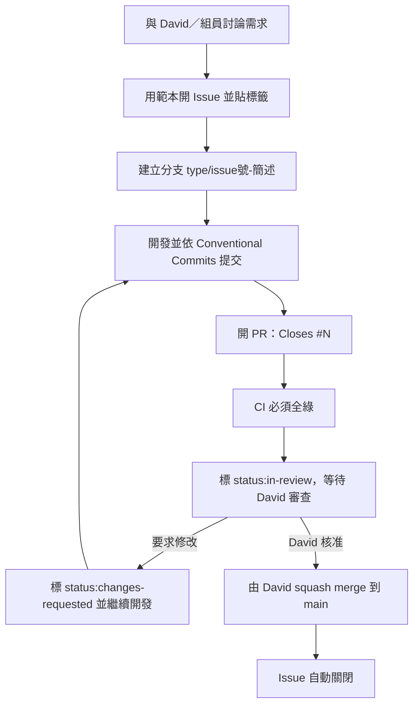

# ReviewStack 協作規範

本文件是 [527lab/ReviewStack](https://github.com/527lab/ReviewStack) 的多人開發規則。所有開發資訊（需求、派工、進度、卡住、審查結論、合併紀錄）都經由 GitHub 的 Issue、Pull Request、Review 與留言傳遞，不另外使用交接檔或站外頻道作為正式紀錄。

更完整的專案介紹見 [README.md](./README.md)。

## 角色與權限

| 角色 | 職責 | 權限界線 |
| --- | --- | --- |
| David（@DavidWu94） | 確認需求、進行 Code Review、核准並合併 PR | **CR 核准與 merge 權限只在 David 身上** |
| 組員（GitHub team `ReviewStack_dev`） | 開 Issue、開分支、提交 commit、開 PR、在 PR 上討論 | Write；不可改 repo 設定、不可自行核准 CR、不可合併到 `main` |
| Coding agent（Claude Code 等） | 依 Issue 實作並開 PR | 與組員相同的協作流程；產出的 PR 必須加上 `agent` 標籤 |

## Issue 規則

- 一個 Issue 對應一個可獨立驗收的小任務，不要把多個不相干的功能寫在同一張 Issue。
- 標題以**動詞**開頭，例如「新增瑕疵標記轉退件單」「修正縮圖載入失敗」。
- 必須使用 [Issue 範本](.github/ISSUE_TEMPLATE/)，並填寫：
  - **背景**：為什麼要做、現況是什麼
  - **驗收條件**：怎樣才算完成，盡量可檢查、可測試
  - **相依的 Issue**：若有先後關係請標出（例如「需先完成 #12」）；沒有就寫「無」
  - **標籤**：至少一個 `type:*`，需要時再加上 `priority:*`、`area:*`
- 開始實作時加上 `status:in-progress`；卡住時加 `status:blocked`；需要 David 決定時加 `status:needs-decision`，並在留言第一段用五句以內說明卡點與需要的決定。
- 派工內容直接寫在 Issue 內文，不另外放任務檔。

## 分支規則

- 禁止直接 push 到 `main`，也禁止 force push（任何分支皆避免；`main` 由保護規則禁止）。
- 一個 Issue 只開一個分支，完成後以一個 PR 合回 `main`。
- 分支命名：`<type>/<issue號>-<簡述>`
  - `type` 使用：`feature`、`fix`、`docs`、`refactor`、`test`、`chore`、`ci`
  - 簡述用小寫英文或拼音，單字以連字號分隔
- 範例：
  - `feature/12-defect-to-rejection`
  - `fix/18-thumbnail-loading`
  - `docs/3-contributing-guide`
  - `chore/21-ci-workflow`

## Commit 規則

採用 [Conventional Commits](https://www.conventionalcommits.org/)。格式：

```text
type(scope): 描述 (#issue)
```

- `type` 必填，限用下表。
- `scope` 建議填寫，例如 `frontend`、`backend`、`ai`、`storage`、`infra`、`review`、`auth`、`ci`。
- 描述用現在式、簡潔說明「做了什麼」，不要只寫 `update` 或 `fix bug`。
- 訊息結尾必須附上 `(#issue號)`，方便對應 Issue。
- 一個 commit 只做一件事；不要把不相干的修改混在一起。

| type | 用途 |
| --- | --- |
| `feat` | 新功能 |
| `fix` | 修復缺陷 |
| `docs` | 只改文件 |
| `style` | 格式、空格、lint，不影響語意 |
| `refactor` | 重構，不新增功能也不修 bug |
| `test` | 新增或修改測試 |
| `chore` | 雜務、依賴更新、維護工作 |
| `ci` | CI／GitHub Actions 設定 |
| `perf` | 效能改善 |

範例：

```text
feat(review): 新增瑕疵標記一鍵轉成退件單 (#12)
fix(api): 修正縮圖載入失敗未回傳錯誤訊息 (#18)
docs(contributing): 補充 PR 截圖與風險欄位說明 (#3)
test(backend): 補上圖片上傳的單元測試 (#20)
chore(infra): 調整 .gitignore 排除 MinIO 資料 (#8)
ci: 新增 GitHub Actions 測試流程 (#21)
```

## Pull Request 規則

- 一個 PR 對應一個 Issue、一個分支。
- 必須使用 [PR 範本](.github/pull_request_template.md)。
- 描述開頭寫 `Closes #N`（或 `Fixes #N`），合併後會自動關閉對應 Issue。
- 必須包含：摘要、變更內容、測試方式、風險；有 UI 變更時附截圖或錄影。
- CI 必須全綠才能合併。
- 審查結論一律寫在 PR Review，不要只在站外口頭告知。
- 需要修改時，審查者會標 `status:changes-requested`；送審時標 `status:in-review`。
- 使用 **Squash and merge**，squash 後的 commit 訊息需符合 Conventional Commits，並保留 `(#issue號)`。
- **只有 David（@DavidWu94）可以核准 Code Review 並合併到 `main`。** 組員與 agent 可以互相留言討論，但不能代替 David 核准或合併。
- 由 coding agent 產出的 PR 必須加上 `agent` 標籤。
- 禁止直接 push `main`、禁止 force push、禁止刪除 `main`。

## 標籤說明

開 Issue／PR 時依需要貼上，可複選不同類別（例如同時有 `type:feature`、`priority:high`、`area:ai`）。

### 類型（`type:*`）

| 標籤 | 說明 |
| --- | --- |
| `type:feature` | 新功能 |
| `type:bug` | 缺陷或錯誤 |
| `type:docs` | 文件 |
| `type:chore` | 雜務、維護、依賴或設定調整 |
| `type:refactor` | 重構，行為不變 |
| `type:test` | 測試相關 |

Issue 範本會自動套用對應的 `type:*` 標籤（功能 → `type:feature`，缺陷 → `type:bug`，任務 → `type:chore`）。若任務其實是重構或測試，請自行改標。

### 優先順序（`priority:*`）

| 標籤 | 說明 |
| --- | --- |
| `priority:high` | 高優先，應盡快處理 |
| `priority:medium` | 中優先，依規劃進行 |
| `priority:low` | 低優先，可延後 |

### 狀態（`status:*`）

| 標籤 | 說明 |
| --- | --- |
| `status:ready` | 已可開始實作 |
| `status:in-progress` | 進行中 |
| `status:blocked` | 被相依條件或外部因素卡住 |
| `status:needs-decision` | 需要 David 或組員做決定 |
| `status:in-review` | PR 已送出，等待審查 |
| `status:changes-requested` | 審查要求修改，尚未再送審 |

同一時間原則上只保留一個 `status:*` 標籤。

### 範圍（`area:*`）

| 標籤 | 說明 |
| --- | --- |
| `area:frontend` | 前端（Vue 3／React、Tailwind） |
| `area:backend` | 後端（FastAPI、業務邏輯、API） |
| `area:ai` | AI 評分、瑕疵偵測等外掛或模型整合 |
| `area:storage` | 檔案與物件儲存（MinIO 等） |
| `area:infra` | 基礎設施、CI、部署、資料庫設定 |

### 其他

| 標籤 | 說明 |
| --- | --- |
| `agent` | 此 Issue 或 PR 由 coding agent 產生或主要實作 |
| `good first issue` | 適合新加入組員的起步任務 |

## 開發流程



文字流程：討論需求 → 開可驗收的 Issue → 開對應分支 → 開發並 commit → 開 PR（`Closes #N`）→ CI 通過 → David 審查 → 如需修改則更新同一分支 → David 核准後 squash merge。

## 卡住或需要決定時

在對應的 Issue 或 PR 留言，**第一段用五句以內寫摘要**（做了什麼、卡在哪裡、需要什麼決定），並貼上 `status:blocked` 或 `status:needs-decision`。進度以 GitHub 事件為準（開 PR、留言、Review、CI 結果），不要另建定時檢查來取代這些紀錄。
