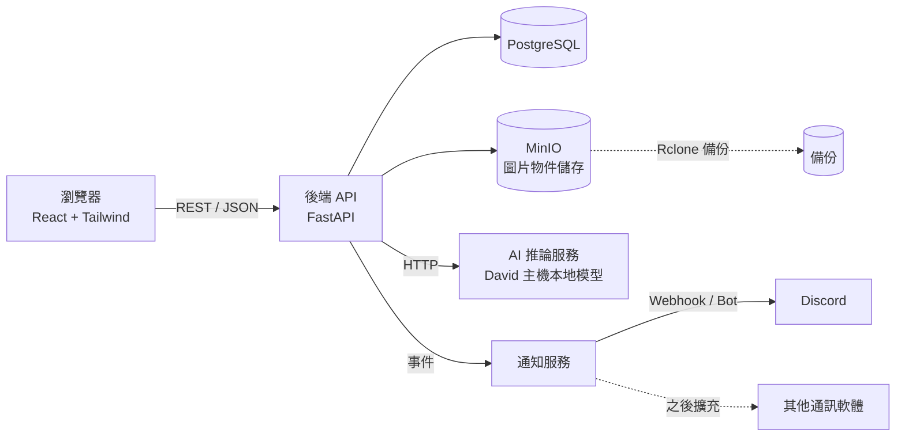
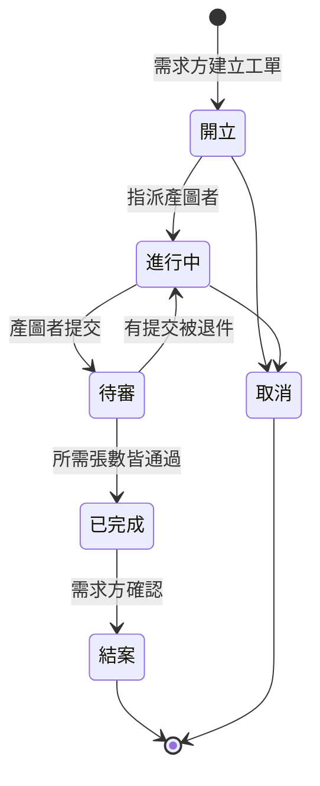
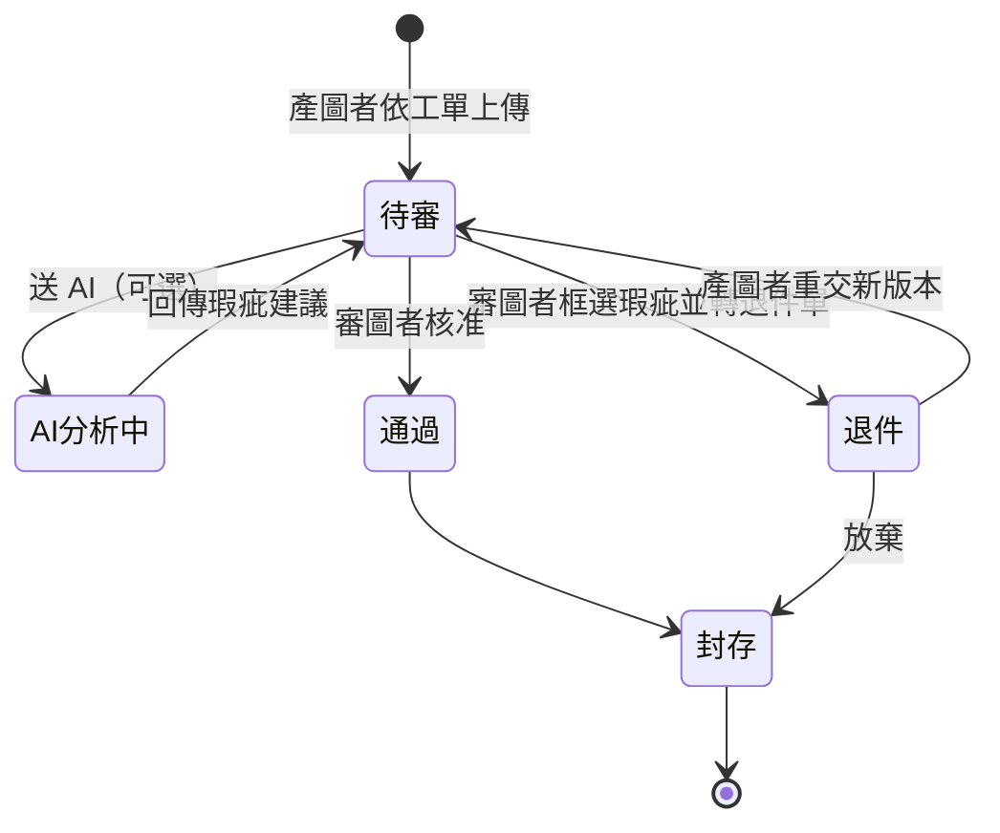

# ReviewStack 系統架構

> 狀態：草稿｜負責人：@DavidWu94｜對應 issue：#2
> 範圍：元件架構、審圖流程、角色權限。資料表見 #11，API 規格見 #12。
> 標註 `TODO` 的地方待討論後填寫；修改請走 PR。

## 1. 目標與範圍

- **一句話定位**：需求以工單派給產圖者；AI 在圖上框出瑕疵，審圖者一鍵轉成退件單；並從審圖紀錄學出團隊的審圖標準。
- **M1（第一次口試，大三下）**：開工單 → 產圖者依工單上傳 → 審圖框選瑕疵 → 轉退件單 → 重交 → 通過；AI 瑕疵定位雛形。
- **M2（第二次口試，大四上）**：學習團隊審圖標準、通訊軟體通知（Discord 優先）、標籤與資產管理、部署與測試。
- **選做**：線上修圖。
- **不做**：TODO

## 2. 名詞

| 名詞 | 說明 |
|---|---|
| 工單 | 需求方開給產圖者的作圖需求：說明、參考圖、規格、數量、期限、指派對象 |
| 提交 | 產圖者針對工單上傳的一張圖，可多次重交成為多個版本 |
| 退件單 | 審圖者依瑕疵標記產生的修改要求，附在該次提交上 |
| 瑕疵標記 | 圖上的框選區域，來源為 AI 或人工 |

## 3. 角色與權限

| 角色 | 可以做 | 不能做 |
|---|---|---|
| 需求方／管理員 | 開工單、指派產圖者、結案、管理使用者與標籤、還原軟刪除 | TODO |
| 產圖者 | 查看指派給自己的工單、依工單上傳與重交、查看退件單 | 審圖、改別人的圖 |
| 審圖者 | 框選瑕疵、通過／退件、套用 AI 建議 | 刪除圖片 |

TODO：需求方是否獨立成一個角色，或由管理員兼任。

## 4. 元件架構

| 元件 | 技術 | 職責 | 部署位置 |
|---|---|---|---|
| 前端 | React + Tailwind | 工單、清單、審圖標註介面、退件單 | TODO |
| 後端 | FastAPI | 權限、工單與審圖流程、API、發出事件 | TODO |
| 資料庫 | PostgreSQL | 結構化資料（詳見 #11） | TODO |
| 物件儲存 | MinIO | 參考圖、提交圖與各版本 | TODO |
| AI 服務 | TODO（待 #4 選型） | 瑕疵定位、分數 | David 主機 |
| 通知服務 | TODO（Webhook 或 Bot） | 把工單與審圖事件推到通訊軟體 | TODO |

- **AI 服務離線時**：後端降級為純人工審圖，不阻擋流程。
- **通知失敗時**：只記錄並重試，不影響工單與審圖流程。

## 5. 工單流程

## 6. 提交與審圖流程

## 7. 通知事件（M2，Discord 優先）

| 事件 | 通知對象 |
|---|---|
| 工單指派 | 被指派的產圖者 |
| 提交待審 | 審圖者 |
| 退件 | 產圖者（附退件單連結） |
| 工單完成 | 需求方 |
| 工單逾期 | 產圖者與需求方 |

TODO：Discord 帳號如何與系統使用者綁定；用頻道 Webhook 還是 Bot 私訊。

## 8. 部署與環境

- 開發：`docker compose up`（#3）
- 正式 demo：TODO（部署位置、網址、AI 服務如何連到主機）
- 機密：只放 `.env`，repo 只放 `.env.example`

## 9. 非功能需求

- 單張圖片上限：TODO MB；格式：PNG / JPG / WebP
- 圖片與 AI 分析不送第三方雲端；通知只送文字與系統連結，不附原圖
- TODO：效能、同時使用人數

## 10. 待決事項

- [ ] 前端與後端的部署位置
- [ ] 是否支援多專案
- [ ] 需求方是否獨立角色
- [ ] 通知方式（Webhook 或 Bot）與帳號綁定
- [ ] AI 模型（#4）
- [ ] 瑕疵類型定義（#5）
