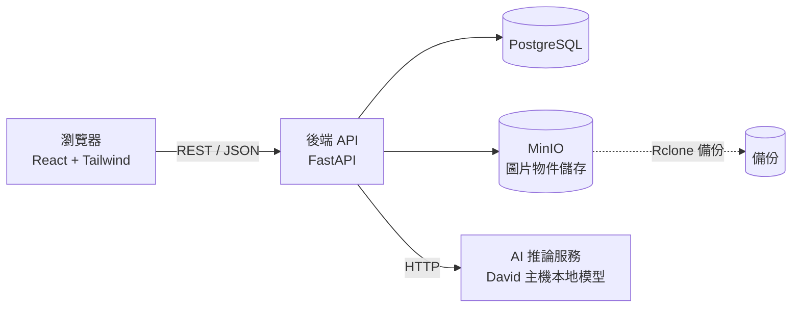
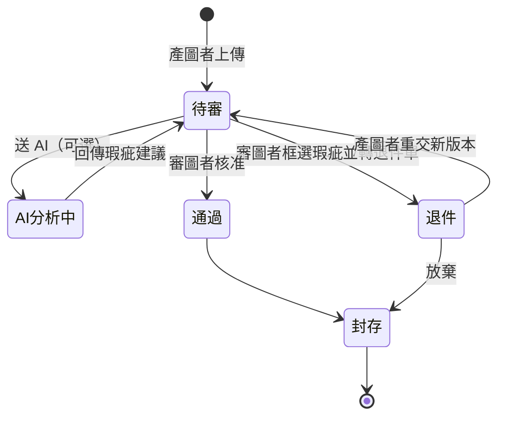
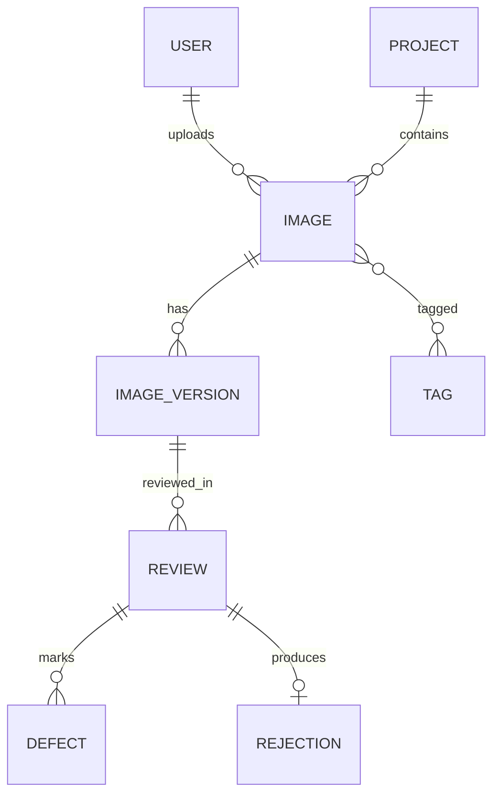

# ReviewStack 系統架構

> 狀態：草稿（範本）｜負責人：@DavidWu94｜對應 issue：#2
> 標註 `TODO` 的地方待討論後填寫；修改請走 PR。

## 1. 目標與範圍

- **一句話定位**：AI 在圖上框出瑕疵，審圖者一鍵轉成退件單；並從審圖紀錄學出團隊的審圖標準。
- **M1（第一次口試，大三下）**：上傳 → 審圖框選瑕疵 → 轉退件單 → 重交 → 通過；AI 瑕疵定位雛形。
- **M2（第二次口試，大四上）**：學習團隊審圖標準、標籤與資產管理、部署與測試、選做功能。
- **不做（或選做）**：線上修圖（選做）、TODO

## 2. 角色與權限

| 角色 | 可以做 | 不能做 |
|---|---|---|
| 產圖者 | 上傳圖片、查看退件單、重交新版本 | 審圖、改別人的圖 |
| 審圖者 | 框選瑕疵、通過／退件、套用 AI 建議 | 刪除圖片 |
| 管理員 | 管理使用者與專案、標籤、還原軟刪除 | TODO |

## 3. 元件架構



| 元件 | 技術 | 職責 | 部署位置 |
|---|---|---|---|
| 前端 | React + Tailwind | 清單、審圖標註介面、退件單 | TODO |
| 後端 | FastAPI | 權限、審圖流程、API | TODO |
| 資料庫 | PostgreSQL | 結構化資料、瑕疵座標（JSONB） | TODO |
| 物件儲存 | MinIO | 原圖、縮圖、各版本 | TODO |
| AI 服務 | TODO（待 #4 選型） | 瑕疵定位、分數 | David 主機 |

**AI 服務離線時**：後端降級為純人工審圖，不阻擋流程。

## 4. 審圖流程狀態



## 5. 資料模型（初稿）



| 資料表 | 主要欄位 | 備註 |
|---|---|---|
| user | id, name, email, role | 角色：producer / reviewer / admin |
| project | id, name | TODO：是否需要多專案 |
| image | id, project_id, uploader_id, status, deleted_at | 軟刪除用 deleted_at |
| image_version | id, image_id, version_no, object_key, width, height | 每次重交一個版本 |
| review | id, version_id, reviewer_id, decision, created_at | decision：pass / reject |
| defect | id, review_id, type, severity, bbox (JSONB), source | source：ai / human |
| rejection | id, review_id, summary, suggestions | 由 defect 自動彙整 |
| tag / image_tag | id, name, source | AI 標籤與人工標籤 |

## 6. 主要 API（初稿）

| 方法 | 路徑 | 說明 |
|---|---|---|
| POST | /api/images | 上傳圖片（#7） |
| GET | /api/images | 清單與篩選（#8） |
| POST | /api/images/{id}/versions | 重交新版本 |
| POST | /api/versions/{id}/ai-analyze | 送 AI 分析 |
| POST | /api/versions/{id}/reviews | 審圖：框選瑕疵、通過或退件 |
| GET | /api/rejections/{id} | 查看退件單 |

## 7. AI 推論服務介面（待 #4、#6）

```json
// POST /infer  (multipart: image)
{
  "defects": [
    {"type": "hand", "bbox": [x, y, w, h], "confidence": 0.87}
  ],
  "model": "TODO",
  "elapsed_ms": 0
}
```

## 8. 部署與環境

- 開發：`docker compose up`（#3）
- 正式 demo：TODO（部署位置、網址、AI 服務如何連到主機）
- 機密：只放 `.env`，repo 只放 `.env.example`

## 9. 非功能需求

- 單張圖片上限：TODO MB；格式：PNG / JPG / WebP
- 圖片與 AI 分析不送第三方雲端
- TODO：效能、同時使用人數

## 10. 待決事項

- [ ] 前端與後端的部署位置
- [ ] 是否支援多專案
- [ ] AI 模型（#4）
- [ ] 瑕疵類型定義（#5）
